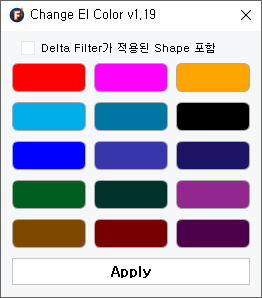
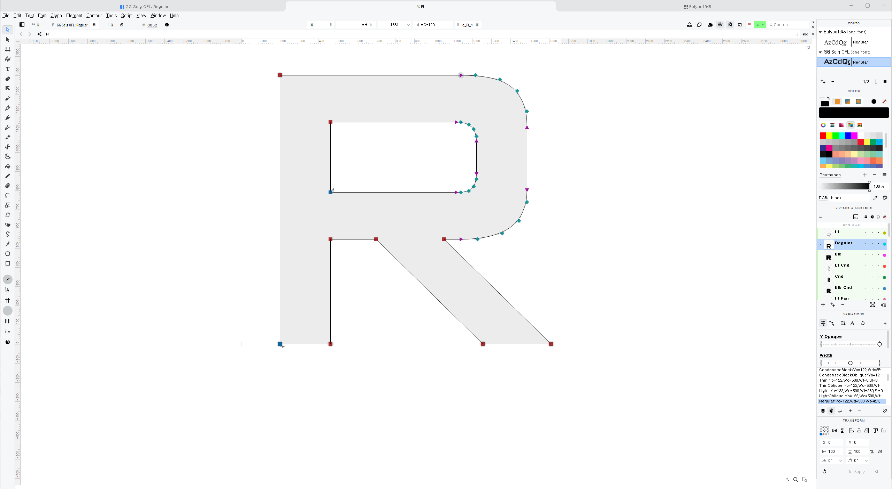
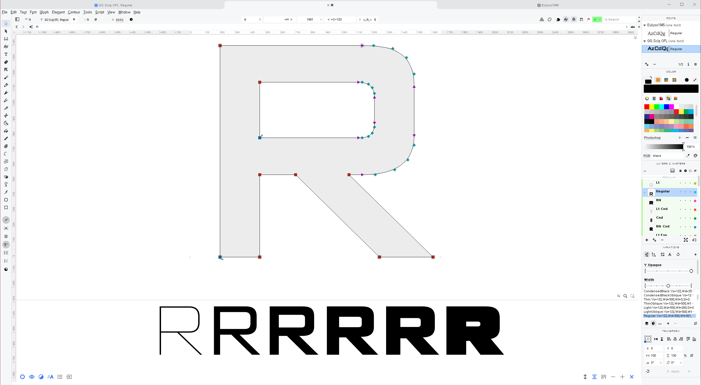
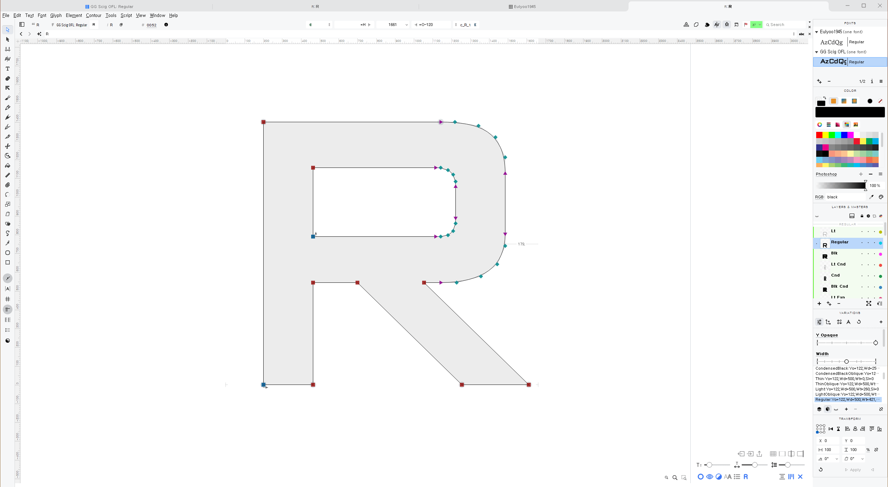

# Dalgas_Change Linked Element Color
Python Script for Fontlab. Fontlab 8/9에서 사용할 수 있는 Python Script입니다.  
Element Reference로 연결된 Shape의 Fill Color을 일괄적으로 모두 변경해줍니다. Element Reference로 연결된 Shape를 Contour Tool 또는 Element Tool로 선택한 후 원하는 색상을 선택하고 Apply 단추를 누르면 색상이 일괄 변경됩니다. Claude.ai에게 부탁해서 만든 Python Script입니다.

This is a Python Script that can be used in Fontlab 8/9. It batch changes the Fill Color of all Contours connected by Element Reference. After selecting the Contours connected by Element Reference using the Contour Tool or Element Tool, choose the desired color and press the Apply button to batch change the colors. This is a Python Script created with the help of Claude.ai.

---

# Dalgas Preview Panel
Fontlab 8/9에서 사용할 수 있는 Python Script입니다.  
폰트랩의 Font Info > Instances에 설정된 정보를 읽어 인터폴레이션 미리보기와 모든 마스터 글자보기를 수행합니다.
특히 인터폴레이션 미리보기는 Font Info > Instances에 설정 모든 인스턴스에 대해 미리보기가 가능합니다.
TypeRig가 설치되어 있어야 합니다.

### 주요 기능

- **가로 모드:** 글리프 창 아래쪽에서 모든 마스터를 나란히 비교하거나, `Font Info > Instances`에 등록한 인스턴스만 보간하여 표시합니다. 일반 보간은 Weight 축을 기준으로 하며, `Ctrl/Command` 또는 `Alt/Option`+보간 버튼 클릭 시 모든 축의 등록 인스턴스를 보여줍니다.
- **세로 모드:** 글리프 창 오른쪽에서 세로쓰기 조판을 미리봅니다. 한글 입력, 열 바꿈, 문자 크기·간격·행간 조절, 창 너비 조절을 지원합니다.
- **세로쓰기 변환:** `R` 버튼으로 문장부호 치환 및 문자 회전을 적용합니다. `Alt/Option`+클릭은 단순 회전, `Ctrl/Command`+클릭은 폰트의 세로쓰기 OpenType 기능을 사용합니다(지원하는 폰트에 한함).
- **텍스트 편집:** 미리보기 창을 Ctrl+클릭하여 직접 텍스트를 입력하고, 글리프 창과 텍스트를 주고받을 수 있습니다. 확대/축소, 이동 및 가이드라인도 지원합니다.
- **설정 저장:** 보기별 확대 비율과 사용자 설정은 FontLab의 `Scripts` 폴더에 있는 `Dalgas_Preview_Panel_Settings.json`에 저장됩니다. 세로쓰기 문장부호 변환 규칙도 사용자 지정할 수 있습니다.

---

**Preview Panel** is a script for FontLab 8/9 that adds horizontal and vertical previews to the Glyph Window. It supports master comparison, custom instance interpolation, vertical typesetting, and Hangul text input. 
Developed collaboratively by a human, FontLab App, Claude, and Codex. TypeRig must be installed.    

### Key Features

- **Horizontal mode:** Compare all masters side by side or preview only the instances defined in `Font Info > Instances`, rather than FontLab’s fixed interpolation steps. Regular interpolation follows the Weight axis; `Ctrl/Command` or `Alt/Option`+click on the Interpolation button shows registered instances across all axes. 
  
  

- **Vertical mode:** Preview top-to-bottom typesetting beside the Glyph Window, with CJK Hangul, Kana, Han input, column breaks, adjustable size/spacing/leading, and resizable panel width. 

- **Text editing:** Ctrl+click (macOS Command+Click) inside the preview panel to enter text directly or exchange text with the Glyph Window. Zooming, panning, and guidelines are also supported.
- **Persistent settings:** View-specific zoom and preferences are saved to `Dalgas_Preview_Panel_Settings.json` in the FontLab `Scripts` folder. Vertical punctuation rules are customizable.

---
The script file is quite large, and I cannot reduce its size any further on my own. I recommend using AI to customize the script to suit your needs.

